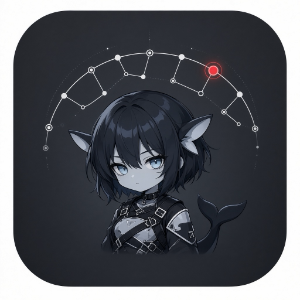
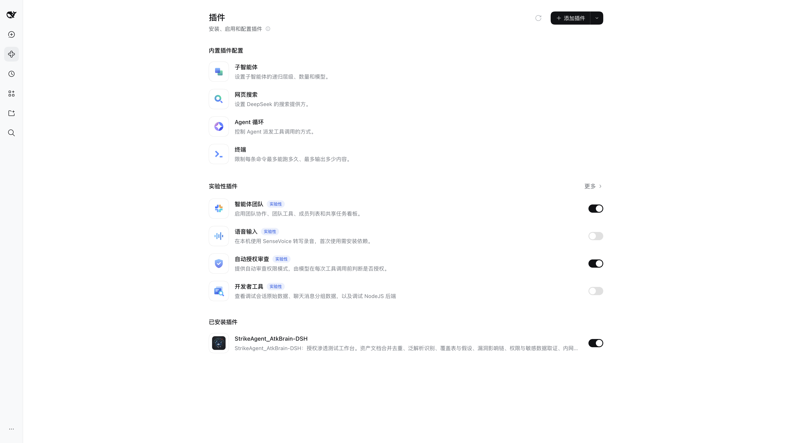
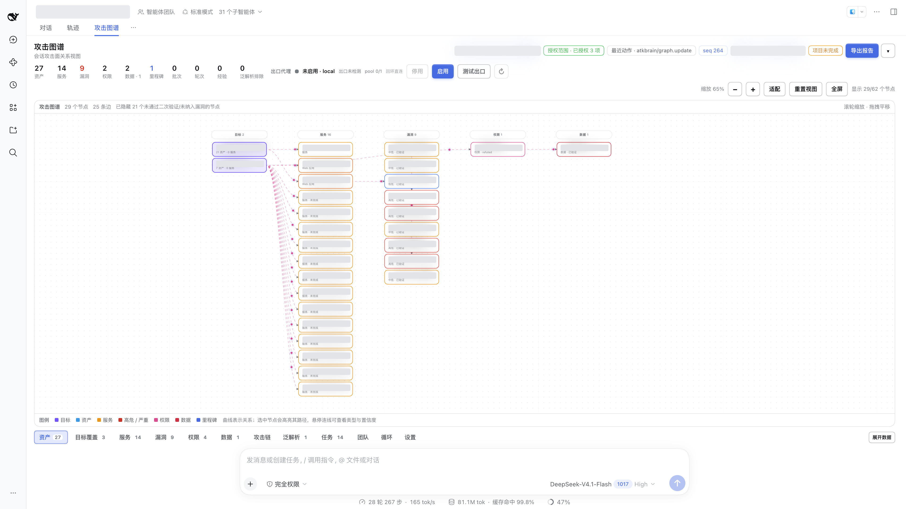
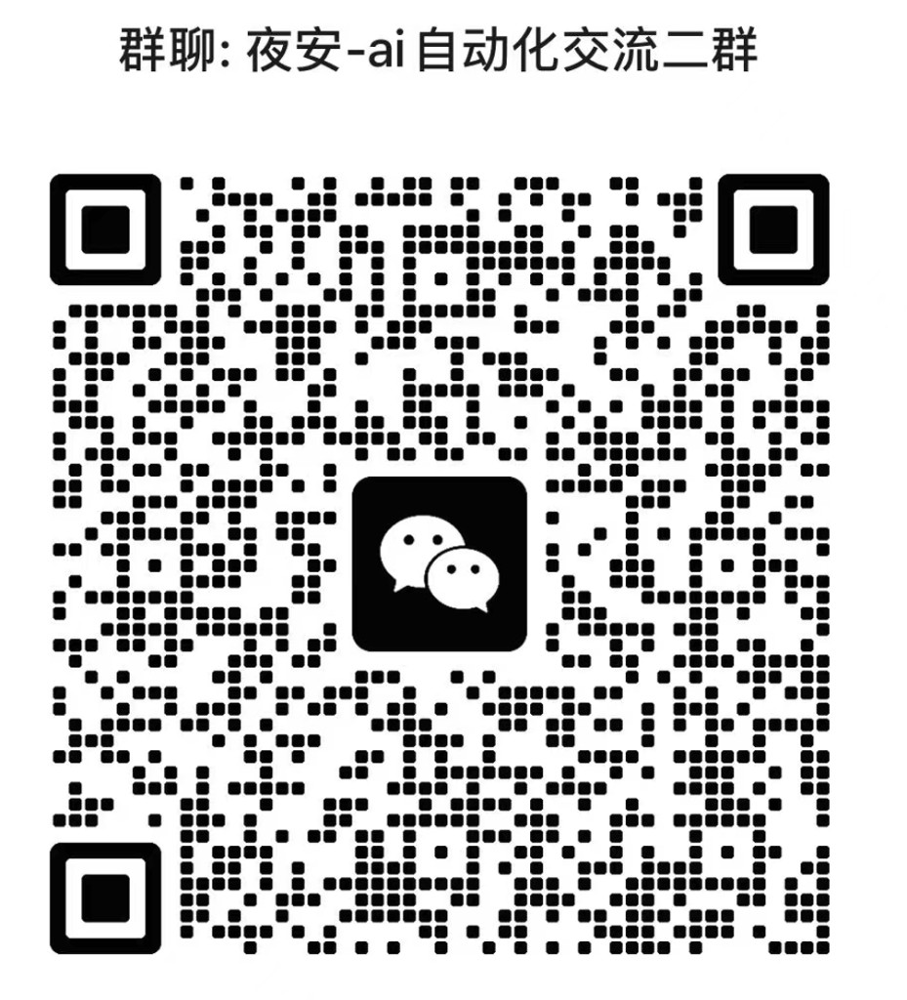

# StrikeAgent_AtkBrain-DSH-Zero

<p align="center">
  
</p>

DeepSeek Harness 的授权渗透测试工作台。一个会话里同时保留对话和攻击图谱：先记范围，再导入资产、探测、记录证据，最后由报告团队写出项目 HTML。

仅用于已有书面授权的评估。没有 allow 列表时不发起网络动作，deny 优先于 allow。

## 界面

插件装好后出现在 DSH 插件列表，会话顶部多一个「攻击图谱」页。

<p align="center">
  
</p>

<p align="center">
  
</p>

## 安装

把本目录的绝对路径装进 DSH。

装好后刷新页面。改了 Host 代码就禁用再启用插件；换包版本需要重启 DSH。

## 使用

1. `atkbrain_scope` 写入授权编号和 allow / deny。
2. `atkbrain_ingest` 导入资产文档，并处理泛解析。
3. 每次行动前看 `atkbrain_query action=frontier`，再用 `atkbrain_probe` 做范围内探测。
4. `atkbrain_record` 记录漏洞、权限和脱敏证据。高危项交给二次验证团队按 CVSS v3.1 评级。
5. 项目完成只认报告团队的项目级 HTML：`atkbrain_selftteam action=report reportType=project`。

资产在当前会话里按授权范围逐个处理。测绘和隧道仍可用。报告和证据写在工作区 `.atkbrain/`。

## 许可证

本项目以 [GNU Affero General Public License v3.0](https://www.gnu.org/licenses/agpl-3.0.html)（AGPL-3.0）开源，完整条款见 [LICENSE](LICENSE)。

可以自由使用、修改和再分发，但必须保留该许可证，并以同一许可证提供修改后的源码。通过网络向用户提供修改后的程序时，也必须提供对应源码。

## 测试

```bash
node --test test/*.js
```

添加微信请备注当前项目，如：SAADZ。

<p align="center">
  
  
</p>
